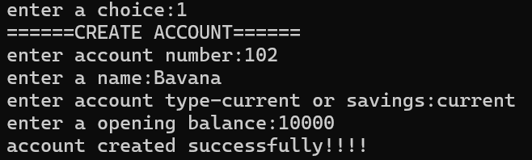

# Python Banking System

A simple, menu-driven, terminal-based banking application developed using Python. The application allows users to create and manage bank accounts and perform basic banking operations through an interactive command-line interface.

## Features

- **Create Account:** Create a new bank account with an account number, account holder's name, account type, and opening balance.
- **View All Accounts:** Display the details of all accounts currently stored in the application.
- **Search Account:** Search for an account using its account number.
- **Update Account Details:** Modify an account holder's name or account type.
- **Deposit Money:** Deposit money into an existing account and view the updated balance.
- **Withdraw Money:** Withdraw money from an account after validating the withdrawal amount against the available balance.
- **Delete Account:** Delete an existing account after confirmation.
- **Input Validation:** Validate account numbers, account names, account types, and monetary amounts to handle common invalid inputs.

## Technologies Used

- **Programming Language:** Python
- **Data Structure:** Dictionary
- **Programming Concepts:** Functions, conditional statements, loops, pattern matching (`match-case`), input validation, and modular programming.

## Project Structure

```text
python-banking-system/
│
├── banking.py
├── bankfunctions.py
├── README.md
├── .gitignore
└── screenshots/
```

- `banking.py` — Displays the main menu and handles user selections.
- `bankfunctions.py` — Contains the functions for account creation, account management, deposits, withdrawals, and account deletion.
- `README.md` — Provides project documentation.
- `.gitignore` — Specifies files and folders that Git should ignore.
- `screenshots/` — Contains screenshots demonstrating the application's functionality.

## Getting Started

### Prerequisites

- Python 3.10 or later.
- Visual Studio Code or another Python-compatible editor (optional).

Python 3.10 or later is required because the application uses `match-case` statements.

### Installation

1. Clone or download this repository.
2. Open the project folder in your editor.
3. Ensure that `banking.py` and `bankfunctions.py` are in the same directory.

### Run the Application

Run `banking.py` using Python.

The application displays a menu with the following options:

1. Create Account
2. View All Accounts
3. Search Account
4. Update Account Details
5. Deposit Money
6. Withdraw Money
7. Delete Account
8. Exit

Select an option and follow the prompts to perform the corresponding operation.

## Data Storage

Account information is stored in a Python dictionary during program execution. The current implementation does not use a database or persistent file storage, so account information is not retained after the program terminates.

## Screenshots

Screenshots demonstrating the application's main menu and banking operations will be added below.

### Main Menu



### Account Management


### Deposit and Withdrawal


## Future Enhancements

- Implement persistent data storage using a database such as SQLite or MySQL.
- Improve input validation and exception handling.
- Add transaction history for deposits and withdrawals.
- Introduce secure user authentication.
- Develop a graphical user interface.

## Author

Developed as a Python programming project.
